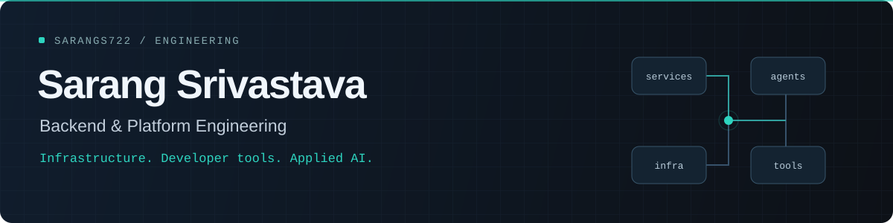

  

  <a href="https://www.linkedin.com/in/sarangs722/">LinkedIn</a> &nbsp;·&nbsp;
  <a href="mailto:sarangs722@gmail.com">Email</a> &nbsp;·&nbsp;
  <a href="./Sarang_Srivastava_Resume_Two_Column.pdf">Resume</a> &nbsp;·&nbsp;
  <a href="https://github.com/sarangs722?tab=repositories">Repositories</a>

I'm Sarang, a **Systems Engineer at Tata Consultancy Services** working in backend and platform engineering since November 2023. I build developer platforms, deployment automation, and applied AI systems that connect language models to real engineering workflows.

My work spans **Python services, Kubernetes, CI/CD, identity and secrets management, and LLM agents**. Outside work, I build Android apps and practical tools for everyday workflows.

## Engineering at work

**Tata Consultancy Services · Systems Engineer · November 2023–Present**

- **AI for platform operations:** Designed and deployed an MCP server exposing **60+ CI/CD and infrastructure operations** to a hosted LLM agent, enabling RAG-assisted builds and deployments through web and Slack. Built a Python/LangGraph SRE agent that maps services, infrastructure, and ownership into a validated knowledge graph, served with FastAPI on Kubernetes.
- **Identity at scale:** Led an enterprise secrets platform's migration to **OpenID Connect**, updating authentication workflows and HashiCorp Vault integrations for **150+ applications handling 5M+ authentication requests per month**.
- **Deployment automation:** Migrated Argo Workflows automation from shell scripts to Python for AWS and Kubernetes workflows supporting **3,000+ engineering teams**. Built a self-service platform for generating CI/CD pipeline configurations.
- **Developer tooling:** Built a reusable CI and AI code-review toolkit for Java microservices, combining changed-line coverage, static analysis, and multi-agent review with findings verification, automated fixes, and prompt-injection safeguards.

## Projects

Android apps, applied AI, developer tools, web applications, and network design.

### [WealthOS](https://github.com/sarangs722/WealthOS)

An **offline-first Android personal wealth tracker** for investments, income, expenses, and net-worth planning. Includes financial projections, encrypted local storage, password-protected portable backups, and validated restore workflows.

`Kotlin` `Jetpack Compose` `Room` `SQLCipher` `Android Keystore`

### ShapeAlchemy

An **Android polygon-merge puzzle game built with Unity**. Swipe matching shapes on a 5 × 6 board to form higher-sided polygons, build chains, and plan around upcoming pieces. Includes procedural jewel graphics, animated merges, undo, a charged Blast mechanic, and persistent game state, with automated gameplay and rendering checks.

`C#` `Unity` `Android` `uGUI` `Procedural graphics`

Source code is private.

### Intelligent Document Retrieval Platform

A **RAG application for multi-document search** with source citations, conversation memory, authentication, persistent chat history, and streaming responses. Built the ingestion pipeline from PDF parsing and chunking through embeddings and semantic indexing.

`Python` `FastAPI` `PostgreSQL` `Vector search` `LLM APIs` `React` `Docker`

Project described in my resume; implementation is not yet published in the public repository.

### [ApplyRecall](https://github.com/sarangs722/apply-recall-job-forms)

A **Chrome extension and local backend** that fill known job-application details and remember explicitly approved answers. Uses deterministic field matching, scoped answer reuse, and revocable extension pairing, with the user reviewing and submitting each application.

`Python` `FastAPI` `SQLite` `JavaScript` `Chrome Extensions / Manifest V3`

### [QR Code & Facial Recognition Attendance System](https://github.com/sarangs722/QRCode-FacialRecog-Attendance-System)

An **Android app and web backend** combining FaceNet facial recognition with QR codes that refresh every **10 seconds** to help deter attendance fraud.

`Kotlin` `Android` `Node.js` `Express` `MongoDB` `FaceNet`

### [OutreachKit](https://github.com/sarangs722/outreachkit-personalized-email)

A **Python CLI for personalized email outreach** using CSV contacts, templates, and the Gmail API. Supports resume attachments, dry-run previews, per-message confirmation, and a local send history to skip duplicate outreach.

`Python` `Gmail API` `OAuth 2.0` `CLI`

### More projects

| Project | What I built |
| :--- | :--- |
| [Unscramble Words](https://github.com/sarangs722/Unscramble-Words-App---Kotlin) | An Android word-unscrambling game with a native declarative interface. **Kotlin · Jetpack Compose** |
| [Download Manager](https://github.com/sarangs722/Download-Manager-Core-Java-Swing) | A desktop GUI for downloading files from URLs, using HTTP connections to retrieve files. **Java · Swing · HttpURLConnection** |
| [News API Web App](https://github.com/sarangs722/NewsApiWebApp) | A news application using API data and server-rendered EJS templates. **Node.js · Express · EJS** |
| [Newsletter Signup](https://github.com/sarangs722/NewsLetterSignupProject) | A newsletter signup flow with a web form, backend API integration, and success/failure pages. **Node.js · Express · HTML · CSS** |
| [Amusement Park Network Design](https://github.com/sarangs722/Amusement-Park-Network-Design) | A Cisco internship network prototype with five network groups, subnetting, DHCP, DNS, web, email, and FTP services. **Cisco Packet Tracer · Networking** |
| [React Portfolio](https://github.com/sarangs722/portfolio-react) | My React-based personal portfolio website. **React · JavaScript** |
| [Original Portfolio](https://github.com/sarangs722/portfoliosite) | My first personal portfolio website, hosted with GitHub Pages. **HTML · CSS · GitHub Pages** |

### Algorithms & practice

[LeetCode solutions](https://github.com/sarangs722/LeetCode) · [6 Companies / 30 Days](https://github.com/sarangs722/6Companies30days) — Java problem-solving repositories.

## Tools I work with

| Area | Technologies |
| :--- | :--- |
| Languages | Python, Java, Go, SQL, Bash; Kotlin, JavaScript, and C# for personal projects |
| Backend & systems | FastAPI, REST APIs, microservices, distributed systems, authentication and authorization |
| Cloud & platform | Kubernetes, AWS / EKS, Docker, CI/CD, GitOps, Argo Workflows, HashiCorp Vault, OIDC |
| Applied AI | MCP, LangGraph, tool calling, agent memory and state, RAG, embeddings, vector databases, LLM evaluation, observability |
| Mobile & games | Android, Jetpack Compose, Unity, uGUI |
| Web & data | React, Node.js, Express, EJS, MongoDB, PostgreSQL, SQLite |
| Developer tools | Git, Claude Code, OpenAI Codex |

## GitHub contributions

Live contribution calendar, served by <a href="https://github.com/2016rshah/githubchart-api">GitHub Chart API</a>. Includes GitHub contributions such as commits, issues, and pull requests. My professional work is described above; this calendar reflects activity visible on my GitHub profile.

[Browse my repositories](https://github.com/sarangs722?tab=repositories) · [View contribution activity](https://github.com/sarangs722?tab=overview)

## Beyond the day job

- **900+ DSA problems solved** across [LeetCode](https://leetcode.com/sarangs722/) and [GeeksforGeeks](https://auth.geeksforgeeks.org/user/sarangs722/practice/).
- **Global Rank 1654**, TCS CodeVita Season 10; **Star of the Month** at TCS.
- **B.Tech (Honours), Information Technology**, ABES Engineering College, 2019–2023 · **8.7/10 CGPA**.
- Completed Anthropic courses in Claude Code, MCP, and the Claude API, plus Cisco's CCNA: Introduction to Networks.

---

Interested in backend systems, developer platforms, or applied AI? [Let's connect on LinkedIn](https://www.linkedin.com/in/sarangs722/) or [send me an email](mailto:sarangs722@gmail.com).
